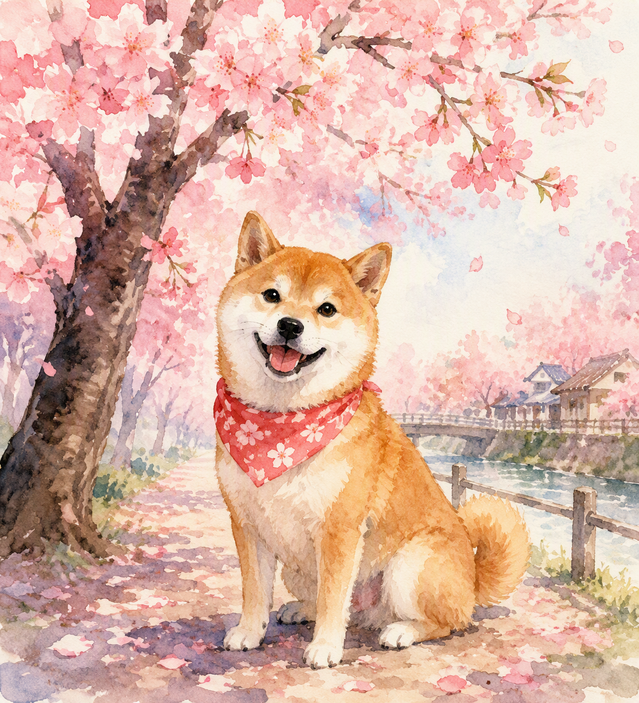

# ComfyUI-EvoLink (Official EvoLink Nodes)

[中文](README.md) | Docs: https://evolink.ai/docs/en/integration-guide/comfyui

Official repository: [Evolink-AI/evolink-comfyui](https://github.com/Evolink-AI/evolink-comfyui) | Registry: [EvoLink (Official)](https://registry.comfy.org/nodes/evolink-nodes)

Generate images and videos inside ComfyUI with [EvoLink](https://evolink.ai) cloud models. **No local GPU required.**

**Image**: GPT Image 2 | Nano Banana 2 / Pro / Lite | Seedream 5.0 Pro / Lite / 4.5 / 4.0 | Qwen Image 3.0 / Pro / Edit Plus | Z-Image Turbo | Krea 2 Turbo | Grok Imagine Image 2.0
**Video**: Sora 2 / Pro | Veo 3.1 (text / first-last / reference) | Kling V3 / Turbo / O3 (incl. reference / video edit / motion control) | Seedance 2.5 (incl. reference / edit / extend) / 2.0 / Fast / Mini | Wan 3.0 | Grok Imagine Video | Hailuo 2.3 | Gemini Omni Flash | Topaz Video Upscale — VIDEO output connects to the native Save Video node, tasks are async & cancellable
**Pipelines**: every node outputs `result_urls` / `response_json`; video edit / extend / upscale nodes accept an upstream node's `result_urls` directly, chaining generate → edit → upscale
**Dynamic**: EvoLink Image / Video nodes cover every model incl. beta channels (new models work without a plugin update); Credits node for balance checks

> One node per model variant (text-to-video and image-to-video are separate nodes), so every parameter you see applies to the model you picked. `first_frame` is a required input on image-to-video nodes.

- ✅ **Zero-friction img2img**: connect "Load Image" to `image1` — local images are
  uploaded through EvoLink's official file channel (auto-deleted after 72h),
  **no third-party image hosting to sign up for**
- ✅ **Your key stays local**: saved to a local config file on first use, leave the
  field empty afterwards — it never travels inside shared workflow JSON
- ✅ **Friendly errors** and full CJK prompt support
- ✅ **Cost-aware**: unchanged parameters re-run from ComfyUI's cache (no re-charge);
  failed / timed-out tasks are never charged

## Install

**ComfyUI-Manager** (recommended): search `EvoLink` → install → fully restart.

**git**

```bash
cd ComfyUI/custom_nodes
git clone https://github.com/Evolink-AI/evolink-comfyui.git
```

**ZIP**: download, unzip into `ComfyUI/custom_nodes/`, make sure `__init__.py`
sits directly inside `custom_nodes/evolink-comfyui/` (no nested folder), then fully restart.

The only dependency is `requests`.

### Existing installations from the personal repository

If you previously cloned the plugin into `comfyui-evolink`, switch the remote in that existing directory. Do not install a second copy:

```bash
cd ComfyUI/custom_nodes/comfyui-evolink
git remote set-url origin https://github.com/Evolink-AI/evolink-comfyui.git
git pull --ff-only
```

Use your actual path if the directory has a different name. Keep the existing directory and local configuration, then fully restart ComfyUI. Manager installations continue to use the same Registry entry, `evolink-nodes`.

## Quick start

1. Get an API key (`sk-...`): https://evolink.ai/dashboard/keys
2. Double-click the canvas → search `EvoLink` → add **EvoLink GPT Image 2 (Official)**
3. Fill `api_key` (first time only) and `prompt`
4. Connect the `image` output to a Preview/Save Image node (**required to see results**)
5. Queue — ~35 s at `quality=low`

**Image-to-image**: Load Image → `image1` → describe the edit in `prompt` → run.
Up to 16 reference images via `image1~4` sockets and/or `image_urls` (one URL per line).

Drag-and-drop examples: [example_workflows/](example_workflows/) — **drag any result PNG straight onto the canvas to restore its full workflow** (workflow metadata is embedded in the images; matching JSON files are also provided).

| Example | Result (drag onto canvas) |
|---|---|
| 01 Text-to-image |  |
| 02 Image-to-image (Ghibli-style redraw, pose preserved) |  |
| 03 Multi-reference (place the subject into a new scene) |  |

## Nodes

| Node | Purpose |
|---|---|
| `EvoLink GPT Image 2 (Official)` | text2img / img2img generation, returns `image`, `task_id`, `status_info`, `result_urls` (raw links, one per line, 24h expiry), `response_json` (full task API response for downstream parsing) |
| `EvoLink Upload Image (Official)` | advanced: local images → official channel → URL text |

## Key safety

Leave the `api_key` field empty after first use (it is read from the local
`evolink_config.json` or the `EVOLINK_API_KEY` env var) so it never ends up in a
shared workflow. Rotate the key at https://evolink.ai/dashboard/keys if leaked.

## Migrating

- **Old official nodes** (delisted repo): same usage — Load Image → `image1`.
- **Community `torans/ComfyUI_EvoLink`**: same parameter names; the imgbb-based
  `Evolink Image Input` node is no longer needed; `poll_interval`/`max_polls`
  became `timeout_seconds`. Both plugins can coexist.

## License

[MIT](LICENSE) © 2026 EvoLink | support@evolink.ai
